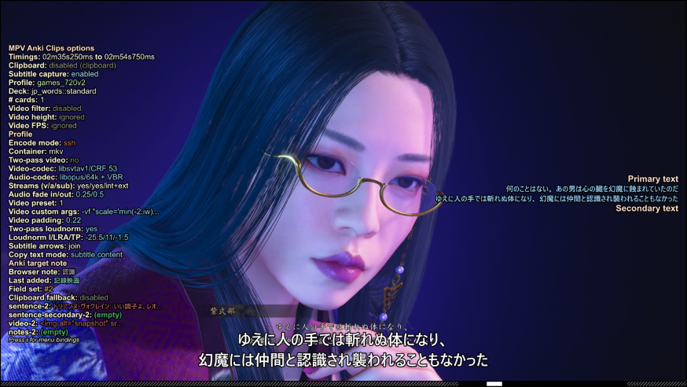

# MPV Anki Clips

*Warning: Fork-native Code generated by AI with human supervision.*

`MPV Anki Clips` is a heavily customized fork of [mpvacious](https://github.com/Ajatt-Tools/mpvacious) for creating and updating Anki notes from video while you watch.



## What This Fork Does

- Create video clips and capture subtitle text.
- Anki integration: export media as a new note or update selected or recent (last added) notes.
- Configure multiple encoding profiles.
- Encode media locally or, optionally, on a remote Windows host.
- Utilize subtitle text with clipboard workflows.
- Queue exports across clients on a trusted LAN and keep structured clip logs.

## Requirements

The add-on needs mpv, Anki with AnkiConnect, curl, and FFmpeg. Other tools below are optional and needed only for the described workflows.

<table>
<tr>
    <th><a href="https://www.gnu.org/gnu/about-gnu.html">GNU/Linux</a></th>
    <th><a href="https://www.gnu.org/proprietary/malware-microsoft.en.html">Windows 11</a></th>
    <th><a href="https://www.gnu.org/proprietary/malware-apple.en.html">macOS</a></th>
    <th>Comments</th>
</tr>
<tr>
    <td><a href="https://wiki.archlinux.org/index.php/Mpv">mpv</a></td>
    <td><a href="https://sourceforge.net/projects/mpv-player-windows/files">mpv</a></td>
    <td><a href="https://mpv.io/installation/">mpv</a></td>
    <td>Use mpv v0.41.0 or newer.</td>
</tr>
<tr>
    <td><a href="https://wiki.archlinux.org/index.php/Anki">Anki</a></td>
    <td colspan="2" align="center"><a href="https://apps.ankiweb.net/">Anki</a></td>
    <td></td>
</tr>
<tr>
    <td colspan="3" align="center"><a href="https://ankiweb.net/shared/info/2055492159">AnkiConnect</a></td>
    <td>Install from AnkiWeb.</td>
</tr>
<tr>
    <td><a href="https://ffmpeg.org/download.html">FFmpeg</a></td>
    <td><a href="https://ffmpeg.org/download.html">FFmpeg</a></td>
    <td><a href="https://ffmpeg.org/download.html">FFmpeg</a></td>
    <td>Required for media encoding.</td>
</tr>
<tr>
    <td><a href="https://www.archlinux.org/packages/core/x86_64/curl/">curl</a></td>
    <td colspan="2" align="center"><a href="https://curl.haxx.se/">curl</a></td>
    <td>Installed by default on supported operating systems except Windows 7.</td>
</tr>
<tr>
    <td><a href="https://www.archlinux.org/packages/extra/x86_64/xclip/">xclip</a> or <a href="https://archlinux.org/packages/extra/x86_64/wl-clipboard">wl-copy</a></td>
    <td></td>
    <td>pbcopy</td>
    <td>Optional clipboard helpers for subtitle-copy workflows; Windows uses PowerShell.</td>
</tr>
<tr>
    <td><a href="https://www.openssh.com/">SSH client</a></td>
    <td><a href="https://www.openssh.com/">SSH client</a></td>
    <td><a href="https://www.openssh.com/">SSH client</a></td>
    <td>Optional; needed on the machine running mpv for remote FFmpeg mode.</td>
</tr>
<tr>
    <td></td>
    <td><a href="https://learn.microsoft.com/windows-server/administration/openssh/openssh_install_firstuse">OpenSSH Server</a></td>
    <td></td>
    <td>Optional; needed on the remote Windows host for remote FFmpeg mode. FFmpeg must also be installed on that host.</td>
</tr>
<tr>
    <td><a href="https://github.com/xiaoyifang/goldendict-ng">GoldenDict</a></td>
    <td><a href="https://github.com/xiaoyifang/goldendict-ng">GoldenDict</a></td>
    <td><a href="https://github.com/xiaoyifang/goldendict-ng">GoldenDict</a></td>
    <td>Optional; needed only for the GoldenDict autoclip workflow.</td>
</tr>
<tr>
    <td></td>
    <td><a href="https://www.powershellgallery.com/packages/BurntToast">BurntToast</a></td>
    <td></td>
    <td>Optional; enables Windows toast notifications for <code>preview_video=toast</code>. Native Windows toast and audible fallbacks are used if it is unavailable.</td>
</tr>
</table>

## Installation

Install the add-on runtime inside mpv's scripts directory. The optional configuration GUI is a separate application. Published ZIPs are attached to this repository's GitHub Releases: open the repository on GitHub and select **Releases**. The add-on runtime and config GUI are separate downloads and must be installed separately.

### Choose and install a release package

The release assets use the same version number, but serve different purposes:

| Package | Typical asset name | Contents and installation |
| --- | --- | --- |
| Add-on runtime | `mpv-anki-clips-v1.2.3.zip` | Platform-independent Lua add-on files under a top-level `mpv-anki-clips/` folder. Extract that folder into mpv's `scripts/` directory as described below. |
| Config GUI for Windows | `mpv-anki-clips-config-v1.2.3-windows-amd64.zip` | `mpv-anki-clips-config/` containing `mpv-anki-clips-config.exe` and `README.txt`. Extract the complete folder to a writable location and launch the executable. |
| Config GUI for Linux | `mpv-anki-clips-config-v1.2.3-linux-x86_64.zip` | `mpv-anki-clips-config/` containing the `mpv-anki-clips-config` executable and `README.txt`. Extract the complete folder to a writable location and launch the executable. |

The version and GUI platform/architecture in filenames vary by release. Choose the GUI asset matching your operating system and architecture. The runtime ZIP is not an installer for the GUI, and the GUI ZIP does not contain the add-on runtime. The GUI can edit settings without the runtime, but its controls take effect in mpv only after the add-on is installed and mpv is restarted or reloaded.

When extracting the runtime ZIP, preserve its top-level folder: the result should be `scripts/mpv-anki-clips/mpv-anki-clips.lua`, not `scripts/mpv-anki-clips/mpv-anki-clips/mpv-anki-clips.lua`. For a clean update, replace the old `mpv-anki-clips` folder with the newly extracted one; this avoids leaving obsolete runtime files behind. Installing or updating the add-on does not edit `input.conf` or overwrite existing files in `script-opts`.

For standard installations, the scripts directory is:

| Platform | Scripts directory |
| --- | --- |
| Windows | `C:\Users\<you>\AppData\Roaming\mpv\scripts\` |
| Linux | `~/.config/mpv/scripts/` |
| macOS | `~/.config/mpv/scripts/` |
| Linux Flatpak (Flathub mpv, `io.mpv.Mpv`) | `~/.var/app/io.mpv.Mpv/config/mpv/scripts/` |

For a Windows portable mpv installation, put the runtime under the `portable_config` folder beside `mpv.exe`:

```text
mpv-portable/
├── mpv.exe
└── portable_config/
    └── scripts/
        └── mpv-anki-clips/
            ├── mpv-anki-clips.lua
            └── ...
```

When `portable_config` exists, mpv uses it as its config root instead of the standard `%APPDATA%\mpv` root. The portable and standard config folders are separate; their settings are not merged. See [First Run And Config Files](#first-run-and-config-files) for the matching `script-opts` paths. Flatpak uses its app-specific config root rather than the host mpv config; sandbox permissions can affect access to files, AnkiConnect, and host tools. See the [Flatpak notes](howto/flatpak.md).

Example with Git:

```bash
git clone <repo-url> ~/.config/mpv/scripts/mpv-anki-clips
```

On Windows, keep the complete `mpv-anki-clips` runtime folder under mpv's `scripts` directory, preserving files such as `mpv-anki-clips.lua`, `main.lua`, `cfg_mgr.lua`, and the `encoder`, `platform`, `subtitles`, and `utils` directories.

## First Run And Config Files

On first mpv load with the script installed, the add-on copies missing core settings, base profile, and profile-list examples into the active config root's `script-opts` directory.

| Config root | Core settings | Base profile |
| --- | --- | --- |
| Windows standard | `%APPDATA%\mpv\script-opts\mpv-anki-clips-core.conf` | `%APPDATA%\mpv\script-opts\mpv-anki-clips-base.conf` |
| Windows portable | `<mpv folder>\portable_config\script-opts\mpv-anki-clips-core.conf` | `<mpv folder>\portable_config\script-opts\mpv-anki-clips-base.conf` |
| Linux standard | `~/.config/mpv/script-opts/mpv-anki-clips-core.conf` | `~/.config/mpv/script-opts/mpv-anki-clips-base.conf` |
| Linux Flatpak (Flathub `io.mpv.Mpv`) | `~/.var/app/io.mpv.Mpv/config/mpv/script-opts/mpv-anki-clips-core.conf` | `~/.var/app/io.mpv.Mpv/config/mpv/script-opts/mpv-anki-clips-base.conf` |
| macOS standard | `~/.config/mpv/script-opts/mpv-anki-clips-core.conf` | `~/.config/mpv/script-opts/mpv-anki-clips-base.conf` |

The shipped [core settings](src/mpv-anki-clips/exampleconfig/mpv-anki-clips-core.conf), [base profile](src/mpv-anki-clips/exampleconfig/mpv-anki-clips-base.conf), and [profile list](src/mpv-anki-clips/exampleconfig/mpv-anki-clips-profiles.conf) document the available settings. Core settings are shared across profiles; the base profile supplies profile-specific defaults, and custom profiles can override those values.

mpv uses one active config root for a given launch; it does not combine the settings in the standard and portable config folders. On Windows, if `portable_config` exists beside `mpv.exe`, that folder is used instead of `%APPDATA%\mpv`. Files saved under the inactive root are not read by that launch. For a Flatpak installation, use the Flatpak app-specific root shown above; it is separate from `~/.config/mpv` used by a non-Flatpak mpv. A custom `--config-dir` (or `MPV_HOME`) can select a different root, so install the script and edit `script-opts` under the root used by the mpv process you launch. The optional [configuration GUI](howto/config_gui.md) can browse to that root.

When upgrading, rename the old main config to `mpv-anki-clips-base.conf` and the profile list to `mpv-anki-clips-profiles.conf`. The core settings file is created if missing and is applied independently, so a same-named value in a profile does not override a core setting. The base profile's filename is `mpv-anki-clips-base.conf`, while its profile name remains `mpv-anki-clips`; custom profile names can remain unchanged. Update note types to use the renamed default fields: `example-sentence-mpv-anki-clips`, `example-sentence-translation-mpv-anki-clips`, and `picture-mpv-anki-clips`. Rename the tag-substitution environment variable to `MPV_ANKI_CLIPS_TAGS` if used.

The optional [portable configuration GUI](howto/config_gui.md) edits these same files and can help inspect config locations.

## Features

- **Note creation and updates:** direct note creation, selected-note and recent-note updates, and Anki's Add Cards window. See [core workflows](howto/core_workflows.md) and the focused guides below.
- **Subtitle capture and text workflows:** choose subtitle lines and timings, copy or transform text, and work with secondary subtitles. See [core workflows](howto/core_workflows.md).
- **Encoding:** local FFmpeg, optional remote FFmpeg over SSH, and test encodes that write media without creating or updating an Anki note. See [remote FFmpeg setup](howto/remote_ffmpeg_ssh.md), the [`h` test-encode binding](howto/bindings.md), and `test_encode_output_dir` in the [core settings example](src/mpv-anki-clips/exampleconfig/mpv-anki-clips-core.conf).
- **LAN queue coordination:** serialize encodes across MPV Anki Clips clients on a trusted private LAN. See [client setup and behavior](howto/lan_queue_coordination.md) and the [Docker coordinator guide](lan_queue_server/README.md).
- **Clip logging:** write structured job records, replace overlapping duplicates, and recover a malformed index. See [clip logging](howto/clip_logging.md).
- **Other integrations:** [Forvo vocabulary audio](howto/forvo_audio.md) and external dictionary workflows; see [GoldenDict](howto/goldendict.md) and [Rikaitan](howto/yomichan.md).

## Core Workflows

Open the advanced menu with `a` to create a note with `Ctrl+n`, update selected Anki notes with `b` / `B`, or update the most recently added note with `Ctrl+m` / `Ctrl+M`. `Ctrl+G` in that menu opens Anki's Add Cards window. Global `Ctrl+g` and `Alt+g` open the quick line-selection and card-count flows.

The [core workflows guide](howto/core_workflows.md) brings together subtitle capture and timing, clipboard and text sources, secondary subtitle controls, field sets, and profiles. For step-by-step note actions, see [create a note](howto/create_card.md), [update selected notes](howto/update_selected_card.md), [open the Add Cards window](howto/add_dialog.md), and [quick cards](howto/create_quick_card.md).

## Advanced Menu Bindings

The advanced menu opens with `a` by default. In the config GUI's **Key bindings** tab, each action's key and **Active in** scope selector appear together in a task-based section. Choose **Advanced menu only** or **Global (any time)**; changing scope moves the existing key between contexts, and **Default** restores both the shipped key and scope. Stable action names remain available in mpv's `input.conf` regardless of scope. See [advanced and global bindings](howto/bindings.md) for defaults and examples.

## Global Bindings

Global defaults include `Ctrl+g` for quick line selection, `Alt+g` for quick card count, `Ctrl+c` / `Ctrl+C` to copy primary/secondary subtitle text, and `Ctrl+v` to toggle secondary-subtitle visibility. See the [full binding reference](howto/bindings.md) for the complete list and context-specific behavior.

## Configuration Highlights

For everyday setup, start with `deck_name`, `model_name`, the `*_field_1` mappings, `copy_text_mode`, and the audio/video encoding settings in the shipped [core settings](src/mpv-anki-clips/exampleconfig/mpv-anki-clips-core.conf) and [base profile](src/mpv-anki-clips/exampleconfig/mpv-anki-clips-base.conf). Optional workflows use settings such as `remote_ffmpeg_enabled`, `queue_server_enabled`, `clip_log_enabled`, and `test_encode_output_dir`; their guides explain the behavior and setup.

## Additional Guides

- [Portable configuration GUI](howto/config_gui.md)
- [Core workflows](howto/core_workflows.md)
- [Advanced and global bindings](howto/bindings.md)
- [Clip logging](howto/clip_logging.md)
- [LAN queue client coordination](howto/lan_queue_coordination.md)
- [LAN queue Docker deployment and operations](lan_queue_server/README.md)
- [Remote FFmpeg over SSH](howto/remote_ffmpeg_ssh.md)
- [Create a note](howto/create_card.md)
- [Update selected notes](howto/update_selected_card.md)
- [Anki Add Cards window](howto/add_dialog.md)
- [Quick card workflow](howto/create_quick_card.md)
- [GoldenDict workflow](howto/goldendict.md)
- [Rikaitan workflow](howto/yomichan.md)
- [Forvo vocabulary audio](howto/forvo_audio.md)
- [Flatpak notes](howto/flatpak.md)
